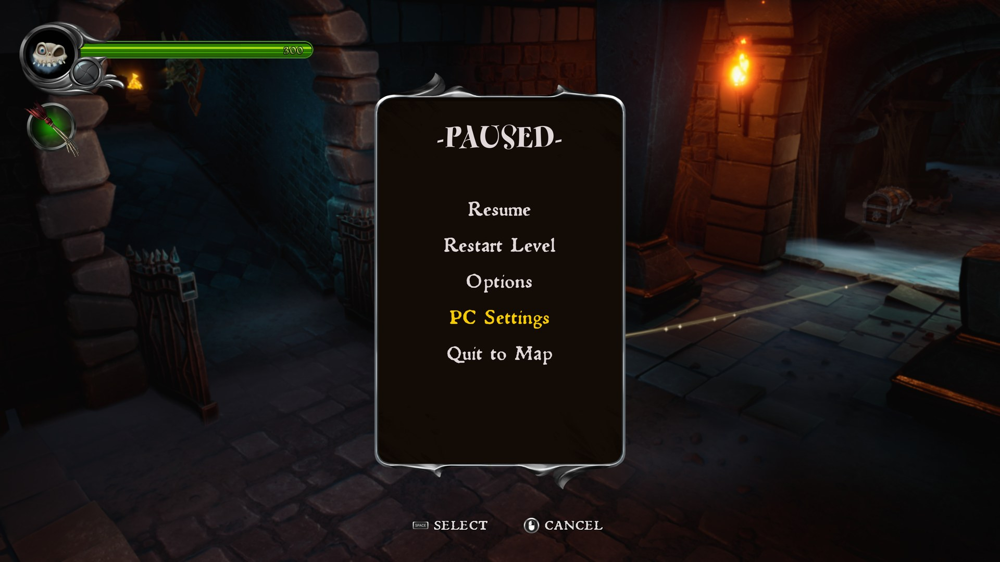
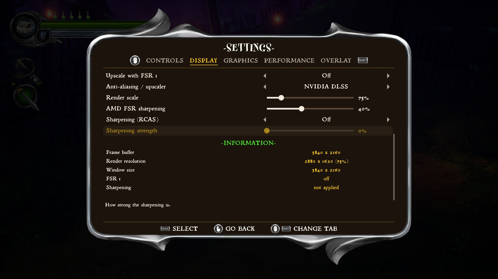
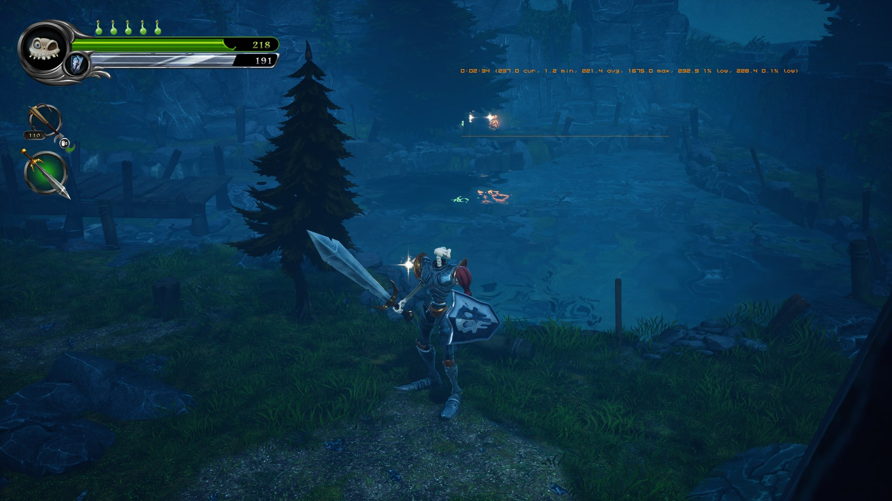
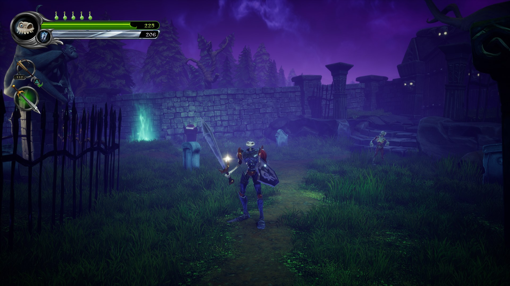
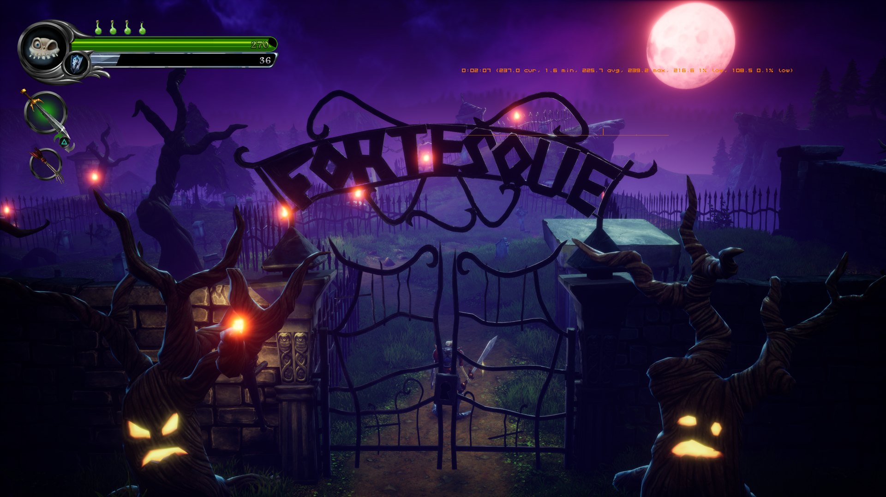
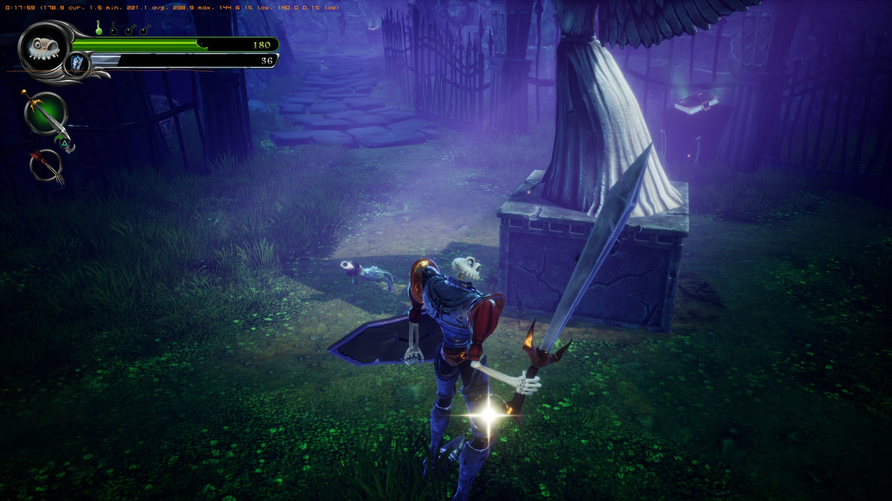
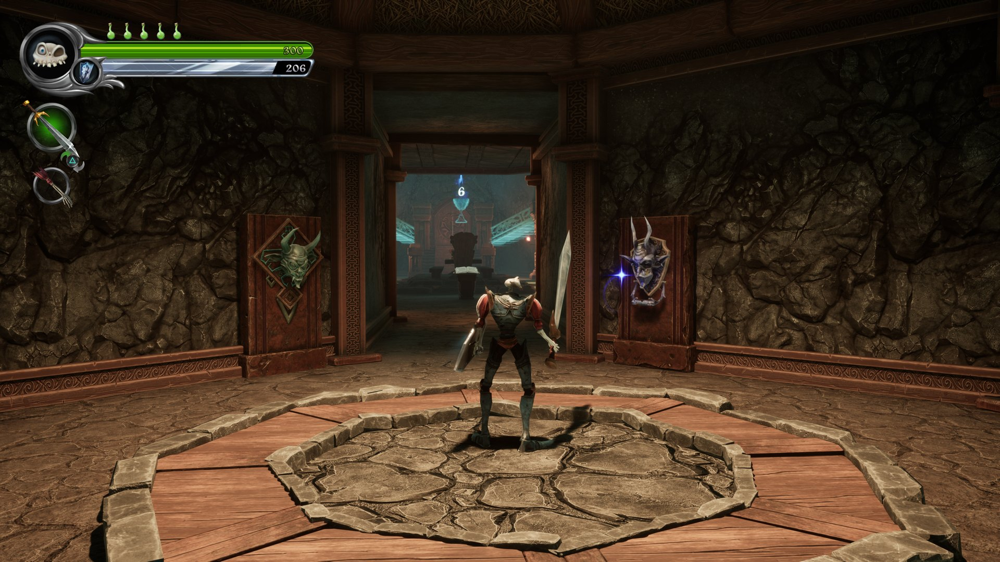
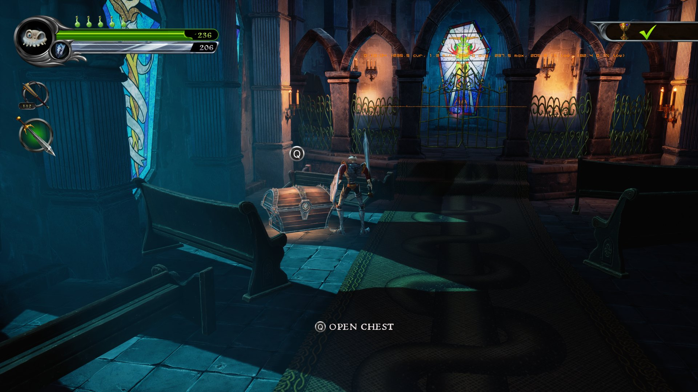

# MediEvil (PS4) for PC

A PC port of **MediEvil** (PlayStation 4, 2019, CUSA11227; the European CUSA12982 works too) for
Windows 10 and 11 and the Steam Deck (Linux), built on the
[God of War III PC port](https://github.com/FelipePrado0/gow3_pc).

The CPU side is native: the game's original x86-64 executable runs directly on the PC's processor
and a runtime written for this port replaces the PS4 system libraries, so there is no CPU emulator.
The graphics run on the [shadPS4](https://github.com/shadps4-emu/shadPS4) video core, which
emulates the PS4 GPU at a high level: it recompiles the game's shaders and translates its GPU
commands to Vulkan.

**How it runs.** On an RTX 4090, the game holds over 200 FPS at native resolution (no upscaling) with steady
1% and 0.1% lows. The Steam Deck holds 60 FPS in the game's heaviest view at its 15 W limit, with ambient
occlusion, reflections and volumetric fog still on.

**Community:** [Discord](https://discord.gg/wyF6jnRpnf) · bug reports and ideas through the launcher's
**Submit Bug Report** button or the [issue tracker](../../issues).

> **No game files are included.** You need your own copy of MediEvil (CUSA11227), as an unpacked
> folder or a fake package (.pkg). This project is not affiliated with Sony Interactive
> Entertainment or Other Ocean. MediEvil is a trademark of Sony Interactive Entertainment.

## What's new in 2.4.0

**A settings menu in the game's own look.** Open it with Insert or R3+L2, or pick **PC Settings** in the game's
pause menu. The menu uses the game's Options frame, fonts and button prompts, and works with the controller, the
keyboard and the mouse.

- Five tabs: **Controls, Display, Graphics, Performance, Overlay**. Most rows apply at once; rows marked RESTART
  wait, and holding **Square + Touchpad** for 5 seconds (or holding the mouse on the prompt) applies them and
  restarts the game.
- The menu and the Load list follow the buttons you bound in the launcher. The arrow keys and Enter always work
  too, as fallbacks.
- The Load list works with the mouse the same way as the menu, and DETAILS has its own button (Triangle).
- With PlayStation prompts, a button bound to another pad button shows that button's picture (the touchpad bound
  to Share shows SHARE).
- Older settings files are updated once, to turn on fixes those versions shipped off by mistake
  (single GPU particle pass, the particle flip guard, "Game reads GPU data without waiting"). Anything you turn
  off afterwards stays off.

| | |
|---|---|
|  |  |
| **PC Settings** in the game's pause menu | Display: upscaler, render scale and sharpening |

**AMD FSR 3.1.** Upscaling for every graphics card: at render scale 100% it is a native-resolution
anti-aliasing, below 100% it upscales. Pick it under Display > Anti-aliasing / upscaler, in the launcher or live
in the game. FSR has its own sharpening slider (AMD FSR sharpening, default 25%). NVIDIA DLSS and FSR now share
one upscaler front end, and its CPU time per frame was cut from about 120 to about 52 microseconds.

*Advanced:* **AMD FSR 4** (v07, INT8) works too, but its model files are not part of the download. Run
`tools/fetch_fsr4_assets.sh` from this repository (Git Bash or WSL) (it downloads AMD's MIT-licensed model files) and put the
`fsr4_shaders` folder next to `run.py`; "AMD FSR 4" then appears in the upscaler list. It is meant for AMD's
newer cards; on an RTX 4090 it costs about 2.7 ms a frame at 4K.

**Sleeping Village water fixed.** Above 1080p the water's refraction overflowed: Dan, his sword or a money bag
were copied into the pond, a hard line cut across it, and the water in the town centre flickered. The water now
shifts the image by the same share of the screen as the PS4 at 1080p. Three rows under Graphics > Effects
resolution, all on by default, each with the game's behaviour as the other choice:

- **Refraction scale**: PS4 scale (the fix) or Game.
- **Water ripples**: Always keeps the water rippling, so the copied scene never shows clearly as an upright copy;
  Game cycle is the game's 5 seconds rippling, 5 seconds still.
- **Refraction edge**: near the top of the screen and under objects in front of the water (the stone arch over
  the pond), the game showed the bare pond bed past a hard line. Stretch fills it with a stretched, rippling image
  instead.



**Also:**
- Steam Deck switches are stored in `medievil.ini`, so the in-game menu (Performance > Deck tuned) and
  "Apply and restart" change them.
- The mouse no longer writes diagnostic lines to the log every few seconds while you play. A tester's recurring
  frame-time dips went away with it.
- The frame buffer size (Display) applies at the next start; changing it live is gone.



## Roadmap

What this fork has done, and what is next. Checked items are in a release or on the default branch.

**Performance and fixes**
- [x] Menus work at 4K; the game boots at any output size
- [x] Output resolution and render scale as separate settings; live render scale (50-200%)
- [x] Unreal's HZB occlusion culling works; the hidden decal prepass is skipped
- [x] Fights: most render pass breaks gone (120 FPS cap: 1% / 0.1% lows 119.7 / 117.4)
- [x] Memory sync and draw-translation CPU cuts; no stalls when Windows trims memory
- [x] Frame pacing above 60 FPS: Reflex limiter, automatic frame limit, precise vblank tick
- [x] Shadow black boxes, a draw-pipe crash / freeze and vanishing GPU particles fixed
- [x] Wrong lighting (teal or white walls, purple reflections) after a level load fixed
- [ ] Hang at "quit to main menu" (found: a deadlock between two GPU threads)
- [ ] Occasional crash at startup (restarting works)

**Game and platforms**
- [x] Game update 01.02 supported
- [x] Steam Deck / Linux: native AppImage, Deck Optimized preset (60 FPS in the heaviest view)
- [ ] Deck: steadier frame times at the 60 FPS cap
- [ ] Deck: freeze after quitting from Steam

**Graphics**
- [x] Graphics quality levels (Ultra to Low, Deck Optimized) with 18 individual settings, Console = the PS4's values
- [x] Real Unreal motion vectors and camera-cut detection for temporal upscalers
- [x] NVIDIA DLAA and DLSS upscaling, in the launcher, the in-game menu and on F9
- [ ] DLSS model (preset) per quality mode
- [x] AMD FSR 3.1 upscaling on the same inputs; FSR 4 for advanced users ([#1](../../issues/1))
- [x] Sleeping Village water: refraction at the PS4's scale, no hard line, no copied Dan
- [ ] DLSS and FSR frame generation

**Controls and launcher**
- [x] Xbox and keyboard button prompts in the game, following your remaps
- [x] Mouse look, mouse buttons and wheel, mouse prompts, camera options
- [x] Bug reports from the launcher, Discord
- [x] Settings menu in the game's look, PC Settings in the pause menu, mouse and binds in the menus
- [ ] Mouse in the game's menus
- [ ] Free camera in fixed and scripted camera areas
- [ ] Mouse look on Linux / Steam Deck

## Screenshots

| | |
|---|---|
|  |  |
|  |  |

Windows 11, RTX 4090, 4K. Some show the port's frame statistics along the top.

## Features

**Graphics**
- **Any output resolution** (720p to 4K, your display's size, or any `output_resolution=WxH` in `medievil.ini`):
  the game starts at that size, as a PS4 starts at its TV's, so menus and controller navigation work at every size.
- **Render scale** 50% to 200%: above 100% supersampling, below it the game's own temporal upsampling. Live in
  the game's menu.
- **NVIDIA DLSS** (RTX cards): DLAA at render scale 100, upscaling below it. NVIDIA's `nvngx_dlss.dll` is not
  included: copy it into the `bin` folder ([README-Windows.txt](packaging/windows/README-Windows.txt)).
- **AMD FSR 3.1** (every GPU): native anti-aliasing at render scale 100, upscaling below it, with its own
  sharpening. FSR 4 for advanced users (its model files are a separate download).
- **Graphics quality**: Ultra, High, Console (the PS4's exact values), Medium, Low and Deck Optimized, each a set
  of 18 settings you can change one by one. Anti-aliasing: the game's TAA, FXAA or off.
- **Frame rate**: the PS4 game's 60 FPS cap can be lifted (Engine frame rate) with normal game speed; NVIDIA
  Reflex limiter, an automatic frame limit, VRR (G-Sync / FreeSync) support.

**Controls**
- Controllers (DualSense, Xbox and others through SDL3), keyboard and, on Windows, the mouse; all remappable.
  Every connected controller is read, also while another window has the focus.
- Button prompts in the game: PlayStation (the game's own), Xbox or Keyboard (and mouse), following your remaps.
  Icons: Julio Cacko's [Free Input Prompts](https://juliocacko.itch.io/free-input-prompts) (CC0).
- Stick range for sticks that never reach the edge; the camera's automatic moves switchable (above).

**Game**
- Saving and loading, with a backup of your saves before every start. The port's **Load list** shows each save's
  slot, level picture, chalices, levels, gold, bestiary entries and play time; Continue loads the newest.
- **All the game's languages**, whatever region your copy is from, and the **voice language** separately (15 dubs).
- **Cheats** (launcher > Game > Cheats): the developers' own debug menu (in a level; 01.00: R3, 01.02: hold L1 + R1, then R3) with
  level select, invincibility, all weapons and more, and unlimited ammo.
- Both game versions, 01.00 and 01.02, of CUSA11227 and CUSA12982.
- Audio (Wwise, ATRAC9, AAC) with the game's 7.1 mixed down properly for stereo.
- Online features answer as a console that is not signed in.

**Launcher**
- In MediEvil's style, with the game's own fonts and cover art (read from your copy, never shipped).
- Installs from a fake PKG, handles mods and patches, save backups, controls, and checks this fork for updates.
- **In-game menu** in the game's own look (Insert or your chosen key, R3+L2, or **PC Settings** in the pause menu):
  Controls, Display, Graphics, Performance and Overlay tabs, live settings and a performance overlay; controller,
  keyboard and mouse.
- **Screenshots**: F12 saves the game's picture at full resolution in `user/screenshots`.

### Known limits

- Mouse look and mouse buttons are Windows only for now; fixed and scripted camera areas keep the game's camera.
- Going back to the main menu from a level can hang the game (the cause is found, not fixed yet).
- Rarely the game closes during start-up; starting it again works.
- **Radeon RX 400/500 and Vega** (older AMD drivers): some crash when the main menu loads. Try launcher >
  Performance > Safe GPU mode (older AMD GPUs), and send a bug report from the launcher.
- Installing from .pkg files: if your 01.02 update package holds only the changed files, unpack the base game's
  .pkg first, then the update into the same folder.

## Download and play

**Windows**
1. Download `medievil-windows.zip` from the [Releases page](../../releases/latest) and extract it.
2. Open **`MediEvil.exe`** (Windows may warn that it is not signed: More info, Run anyway).
3. On **Game**, either **Choose .pkg…** to install from your package, or **Browse…** to the folder with `eboot.bin`.
4. Choose an **Output resolution** and **Render scale** on **Home** and press **PLAY**.

`Play MediEvil.exe` starts the game with the saved settings, for shortcuts and Steam. With an empty file
`portable.txt` next to `MediEvil.exe`, the launcher keeps its settings beside it. More in
[README-Windows.txt](packaging/windows/README-Windows.txt).

**Steam Deck and Linux**: download `MediEvil-x86_64.AppImage` from the same page and follow
[README-Linux.md](packaging/linux/README-Linux.md) (Desktop Mode once to pick the game, then Game Mode through Steam).

## Community and bug reports

- [Discord](https://discord.gg/wyF6jnRpnf): help, questions and news.
- **Bug reports**: launcher > **Submit Bug Report**. It attaches what we need (logs and settings, with your names
  removed) to a GitHub issue. Feature requests go the same way.

## This fork

This is BevelTipDrip's fork of [bc160201983's MediEvil port](https://github.com/bc160201983/medievil_2019_pc_port),
**actively maintained**. It contains everything up to upstream 1.3.8, plus performance, correctness and feature
work, each change measured in game. Its releases start at **2.0.0**, and the launcher checks this fork for updates,
so it never offers upstream's builds in place of this one. Every optimisation is a switch (launcher > Performance >
Performance patches, or a `GOW3_*` variable), so each one can be compared on and off.

### For other ports

Ports with the same lineage (shadPS4 video core → the Bloodborne PC port → the God of War III PC port → this
port) are welcome to take any of this, under the same license (GPL v2 or later; keep the copyright headers and
credit the source). Where to start:

- [research/docs/fix-inventory.md](research/docs/fix-inventory.md): every fix with its evidence, commits, files,
  switch, and whether it is general, depends on how MediEvil behaves, or is MediEvil-only.
- [research/docs/gpu-threading-reference.md](research/docs/gpu-threading-reference.md): how the GPU threads,
  waits and memory sync fit together, and the rules learned the hard way.
- [research/docs/START-HERE.md](research/docs/START-HERE.md): the index of the research docs (plans, tests and
  measurements), and [research/patches](research/patches) (one card per change).
- Commit messages name the test (`T-…`) that measured each change. In the video core, changes from shadPS4
  are marked with `gow3:` comments ([gpu/VENDOR.txt](gpu/VENDOR.txt)).

Pointing an LLM at this repo works well: the docs above are written to be read that way.

## Building from source

1. Install [MSYS2](https://www.msys2.org) and, in the **MSYS2 CLANG64** shell, the packages listed
   in [packaging/windows/README.md](packaging/windows/README.md). Install
   [Python 3](https://www.python.org) with `pip install pillow cryptography`.
2. Build (newer CLANG64 toolchains need the standard headers forced for some third-party code):

   ```bash
   git clone --recursive https://github.com/BevelTipDrip/medievil_2019_pc_port
   cd medievil_2019_pc_port
   CXXFLAGS="-include cstdlib -include cstdio -include cwchar -include cmath -include new" bash build.sh
   ```

3. Start the launcher with `MediEvil Launcher.cmd` (or `python launcher/medievil_launcher.py`),
   or the game directly:

   ```powershell
   $env:GOW3_GAME_DIR = 'D:\path\CUSA11227'   # or the .pkg
   python run.py
   ```

4. Package: `bash packaging/windows/package.sh` builds `dist/medievil-windows.zip`.

Linux: see [packaging/linux/README-Linux.md](packaging/linux/README-Linux.md) for building from source and the
AppImage script (first contributed in #13 by @nydal91).

## How it works

| Part | Where | What it does |
|---|---|---|
| PKG install | `scripts/pkg_extract.py` | Decrypts and unpacks fake PKGs (PFS, PFSC), as shadPS4 does |
| Game profiles | `scripts/game_profiles.py` | Modules to link and GPU defaults per title |
| Preparation | `scripts/` | Reads `eboot.bin`, links the game's `libc`, `libSceFios2` and `libSceNpToolkit2` |
| Loader | `src/probe.c` | Loads the image, starts the game's original code, and the hooks into its Blueprints (camera, mouse look) |
| Runtime | `src/runtime_*.c` | PS4 system functions: pad, mouse, audio, saves, files |
| GPU | `gpu/shadps4/` | shadPS4 video core (Vulkan) with the speed work of the ports it is based on |
| Override pak | `scripts/ue4_override.py` | Resolution, quality, frame rate cap, debug menu, unlimited ammo, button prompts |
| Game patches | `patches/MediEvil.xml` | Code patches for 01.00 and 01.02 |
| Launcher | `launcher/` | Settings, PKG install, mods, controls, bug reports and the play button |

To port another PS4 game the same way: the loader stops at the first system function the runtime
does not implement and names it; `scripts/gen_import_names.py` adds a game's imports to the name table.

## Credits

- **bc160201983**: [the MediEvil port](https://github.com/bc160201983/medievil_2019_pc_port) this fork continues.
- **FelipePrado0**: [gow3_pc](https://github.com/FelipePrado0/gow3_pc), the God of War III port
  that port is built on, and its credits: **Supermedo** and **deadinside28** (bloodborne_pc),
  **cuesta4** (shadPS4 GPU fixes).
- **shadPS4 team**: the video core, and the PKG format and fake-PKG keysets used by
  `scripts/pkg_extract.py` (`src/core/file_format/pkg.cpp`, `src/core/crypto`) and the NID name
  list (`tools/aerolib.inl`).
- **Julio Cacko**: [Free Input Prompts](https://juliocacko.itch.io/free-input-prompts) (CC0), the Xbox, keyboard
  and mouse button icons.
- Also used: LibAtrac9, FFmpeg, SDL3, Dear ImGui, sirit, magic_enum, miniz, xbyak, Vulkan Memory
  Allocator, FSR-Vulkan, MSYS2, LLVM, Pillow and cryptography.

## License

GNU GPL v2 or later ([LICENSE](LICENSE)). Third-party components keep their own licenses.
