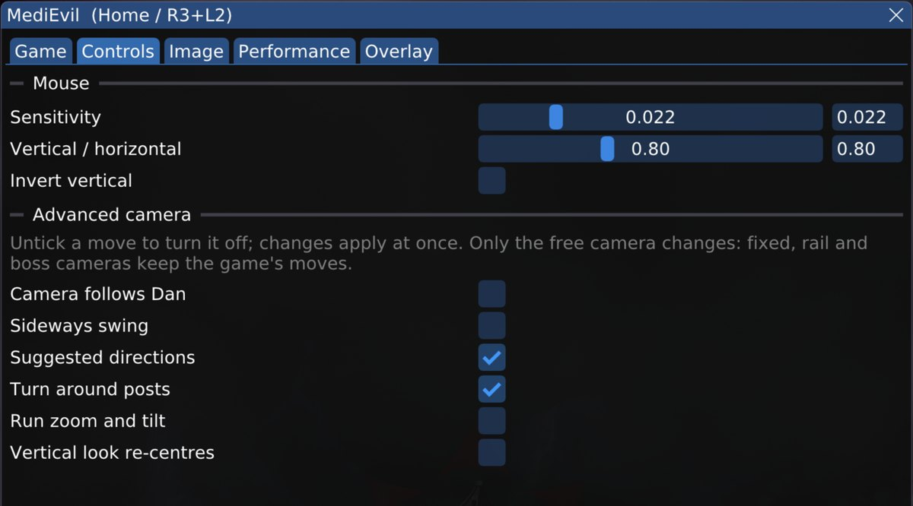
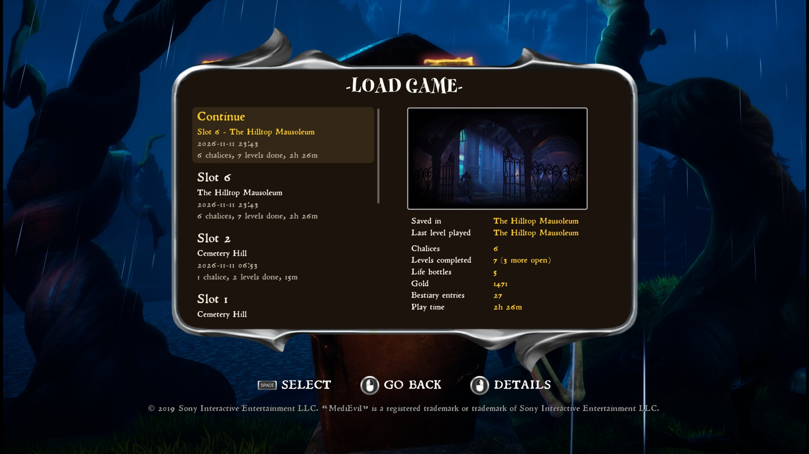
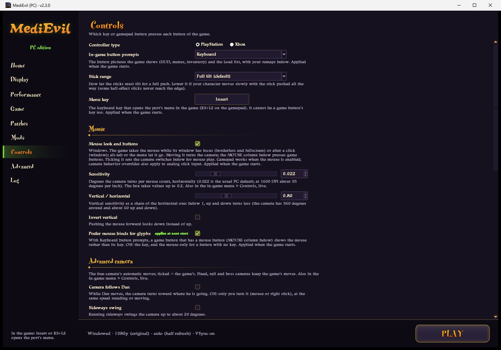
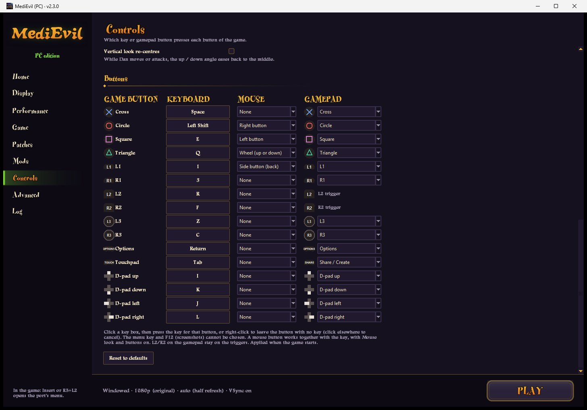
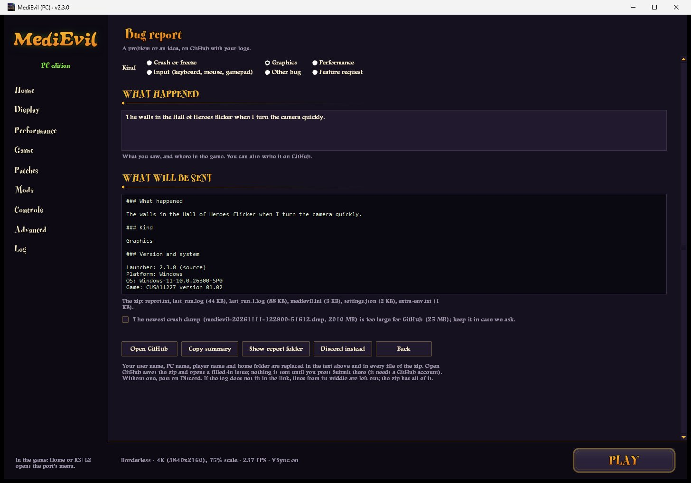
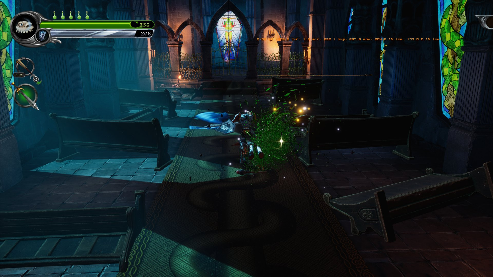
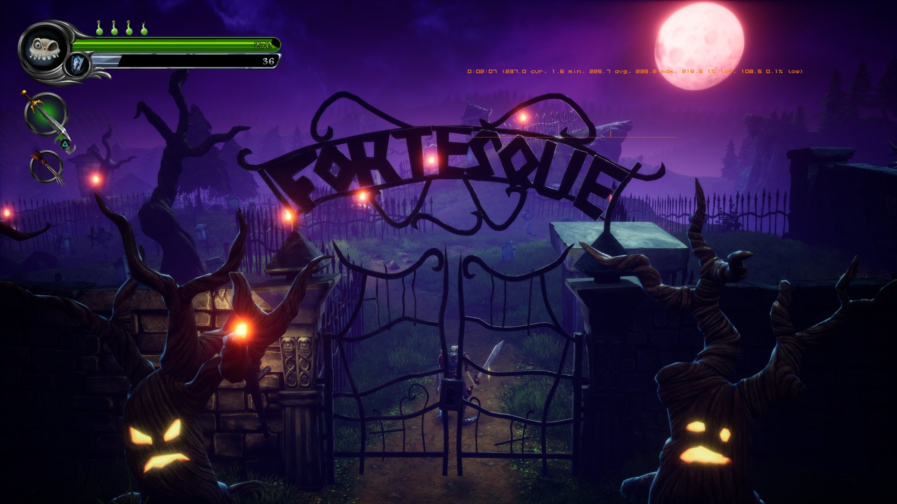
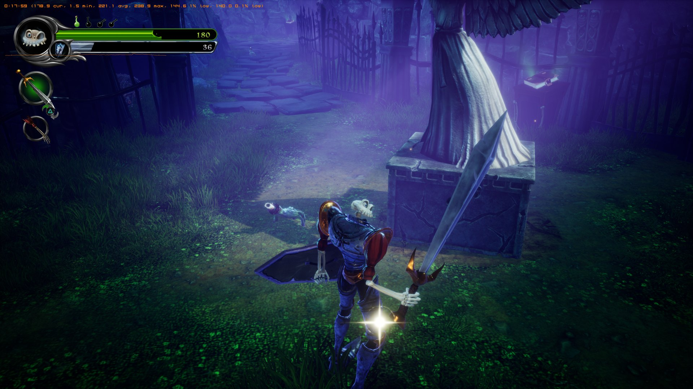
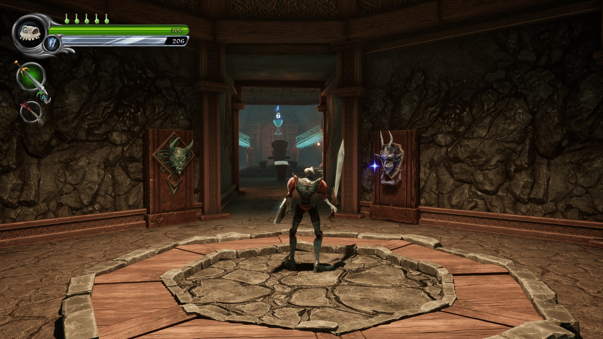
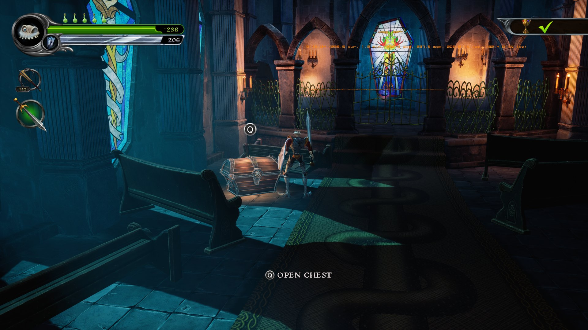

# MediEvil (PS4) for PC

A PC port of **MediEvil** (PlayStation 4, 2019, CUSA11227; the European CUSA12982 works too) for
Windows 10 and 11 and the Steam Deck (Linux), built on the
[God of War III PC port](https://github.com/FelipePrado0/gow3_pc).

The CPU side is native: the game's original x86-64 executable runs directly on the PC's processor
and a runtime written for this port replaces the PS4 system libraries, so there is no CPU emulator.
The graphics run on the [shadPS4](https://github.com/shadps4-emu/shadPS4) video core, which
emulates the PS4 GPU at a high level: it recompiles the game's shaders and translates its GPU
commands to Vulkan.

**How it runs.** On an RTX 4090, the game holds over 200 FPS at native resolution (no upscaling) with steady
1% and 0.1% lows. The Steam Deck holds 60 FPS in the game's heaviest view at its 15 W limit, with ambient
occlusion, reflections and volumetric fog still on.

**Community:** [Discord](https://discord.gg/wyF6jnRpnf) · bug reports and ideas through the launcher's
**Submit Bug Report** button or the [issue tracker](../../issues).

> **No game files are included.** You need your own copy of MediEvil (CUSA11227), as an unpacked
> folder or a fake package (.pkg). This project is not affiliated with Sony Interactive
> Entertainment or Other Ocean. MediEvil is a trademark of Sony Interactive Entertainment.

## What's new in 2.3.0

**Mouse and keyboard (Windows).** Launcher > Controls > Mouse > **Mouse look and buttons**.

- **Mouse look** on both axes, in the free camera and in Dan-cam (the aim camera). The mouse turns the camera inside
  the game's own camera update, so both axes respond on the same frame. Sensitivity, vertical / horizontal ratio
  and invert are in the launcher and, live, in the game's menu (Controls tab).
- The game takes the mouse when its window has focus in borderless and fullscreen; Alt+Tab and the menu give it back.
- **Mouse buttons and the wheel press game buttons**: a MOUSE column next to the keyboard's. Wheel up, wheel down,
  or "wheel (up or down)", which is one press per scroll, so a fast scroll switches weapons once.
- **Mouse button prompts**: with Keyboard prompts, buttons bound to the mouse show a mouse icon, in the game and
  in the Load list ("Prefer mouse binds for glyphs").
- **Keys**: right-click a key box while it waits for a key to leave that button without one. The key that opens
  the port's menu (Insert) can be changed, for keyboards without Insert.

| | |
|---|---|
|  |  |
| The in-game menu's Controls tab: mouse settings and the camera's automatic moves, live | The Load list with mouse prompts (right button: back, left button: details) |
|  |  |
| Launcher > Controls: mouse, menu key and camera | The MOUSE column beside the keyboard and gamepad |

**Camera options.** The free camera's automatic moves can each be switched off (Controls > Advanced camera, or
live in the game): the camera following Dan, the sideways swing, suggested directions, turning at posts, the
running zoom and tilt, and the vertical re-centre. Ticking Mouse look sets a mouse-friendly mix (only suggested
directions and posts on). The switches apply to the right stick too; fixed, rail and boss cameras keep the
game's moves.

**Submit Bug Report.** A button next to GitHub and Discord. It shows exactly what will be sent, saves a zip of
your logs and settings with your user, PC and player names removed, and opens a filled-in GitHub issue to drag
it into. Nothing is sent until you press Submit on GitHub. The log of the run before is now kept too
(`last_run.1.log`), so a crash's log survives a relaunch.



**Fixes from the community** (upstream PRs, thanks to their authors):
- **Torch flames and other effects missing** while shaders were still compiling: the main menu's torches on the first start, torches in levels, and the trail of small stars behind the firefly that follows Dan. Porticus, [upstream #52](https://github.com/bc160201983/medievil_2019_pc_port/pull/52).
- **Movie ends**: the threads that play a movie no longer race when it stops. On Windows each movie end could wait up to 5 seconds; on Linux and the Steam Deck it could hang (black screen after the logo, or on the world map). dvilelaf, [upstream #68](https://github.com/bc160201983/medievil_2019_pc_port/pull/68).
- **Controllers plugged in after start** are found on more systems. Porticus, [upstream #64](https://github.com/bc160201983/medievil_2019_pc_port/pull/64).
- The Windows zip carries NVIDIA's DLSS licence next to the DLSS bridge.

**Also:** settings the game's menu changes are no longer overwritten by the launcher after the game exits.


*A fight in the Hilltop Mausoleum, RTX 4090, 4K output with DLSS at 75% and a 237 FPS cap: 232 FPS average,
1% low 204, 0.1% low 177 (the port's overlay, top right).*

Earlier versions: see the [Releases page](../../releases).

## Roadmap

What this fork has done, and what is next. Checked items are in a release or on the default branch.

**Performance and fixes**
- [x] Menus work at 4K; the game boots at any output size
- [x] Output resolution and render scale as separate settings; live render scale (50-200%)
- [x] Unreal's HZB occlusion culling works; the hidden decal prepass is skipped
- [x] Fights: most render pass breaks gone (120 FPS cap: 1% / 0.1% lows 119.7 / 117.4)
- [x] Memory sync and draw-translation CPU cuts; no stalls when Windows trims memory
- [x] Frame pacing above 60 FPS: Reflex limiter, automatic frame limit, precise vblank tick
- [x] Shadow black boxes, a draw-pipe crash / freeze and vanishing GPU particles fixed
- [x] Wrong lighting (teal or white walls, purple reflections) after a level load fixed
- [ ] Hang at "quit to main menu" (found: a deadlock between two GPU threads)
- [ ] Occasional crash at startup (restarting works)

**Game and platforms**
- [x] Game update 01.02 supported
- [x] Steam Deck / Linux: native AppImage, Deck Optimized preset (60 FPS in the heaviest view)
- [ ] Deck: steadier frame times at the 60 FPS cap
- [ ] Deck: freeze after quitting from Steam

**Graphics**
- [x] Graphics quality levels (Ultra to Low, Deck Optimized) with 18 individual settings, Console = the PS4's values
- [x] Real Unreal motion vectors and camera-cut detection for temporal upscalers
- [x] NVIDIA DLAA and DLSS upscaling, in the launcher, the in-game menu and on F9
- [ ] DLSS model (preset) per quality mode
- [ ] AMD FSR upscaling on the same inputs (FSR 4 requested: [#1](../../issues/1))
- [ ] DLSS and FSR frame generation

**Controls and launcher**
- [x] Xbox and keyboard button prompts in the game, following your remaps
- [x] Mouse look, mouse buttons and wheel, mouse prompts, camera options
- [x] Bug reports from the launcher, Discord
- [ ] Mouse in the game's menus
- [ ] Free camera in fixed and scripted camera areas
- [ ] Mouse look on Linux / Steam Deck

## Screenshots

| | |
|---|---|
|  |  |
|  |  |

Windows 11, RTX 4090, 4K. Some show the port's frame statistics along the top.

## Features

**Graphics**
- **Any output resolution** (720p to 4K, your display's size, or any `output_resolution=WxH` in `medievil.ini`):
  the game starts at that size, as a PS4 starts at its TV's, so menus and controller navigation work at every size.
- **Render scale** 50% to 200%: above 100% supersampling, below it the game's own temporal upsampling. Live in
  the game's menu.
- **NVIDIA DLSS** (RTX cards): DLAA at render scale 100, upscaling below it. NVIDIA's `nvngx_dlss.dll` is not
  included: copy it into the `bin` folder ([README-Windows.txt](packaging/windows/README-Windows.txt)).
- **Graphics quality**: Ultra, High, Console (the PS4's exact values), Medium, Low and Deck Optimized, each a set
  of 18 settings you can change one by one. Anti-aliasing: the game's TAA, FXAA or off.
- **Frame rate**: the PS4 game's 60 FPS cap can be lifted (Engine frame rate) with normal game speed; NVIDIA
  Reflex limiter, an automatic frame limit, VRR (G-Sync / FreeSync) support.

**Controls**
- Controllers (DualSense, Xbox and others through SDL3), keyboard and, on Windows, the mouse; all remappable.
  Every connected controller is read, also while another window has the focus.
- Button prompts in the game: PlayStation (the game's own), Xbox or Keyboard (and mouse), following your remaps.
  Icons: Julio Cacko's [Free Input Prompts](https://juliocacko.itch.io/free-input-prompts) (CC0).
- Stick range for sticks that never reach the edge; the camera's automatic moves switchable (above).

**Game**
- Saving and loading, with a backup of your saves before every start. The port's **Load list** shows each save's
  slot, level picture, chalices, levels, gold, bestiary entries and play time; Continue loads the newest.
- **All the game's languages**, whatever region your copy is from, and the **voice language** separately (15 dubs).
- **Cheats** (launcher > Game > Cheats): the developers' own debug menu (in a level: R3; 01.02: L1 + R1 + R3) with
  level select, invincibility, all weapons and more, and unlimited ammo.
- Both game versions, 01.00 and 01.02, of CUSA11227 and CUSA12982.
- Audio (Wwise, ATRAC9, AAC) with the game's 7.1 mixed down properly for stereo.
- Online features answer as a console that is not signed in.

**Launcher**
- In MediEvil's style, with the game's own fonts and cover art (read from your copy, never shipped).
- Installs from a fake PKG, handles mods and patches, save backups, controls, and checks this fork for updates.
- **In-game menu** (Insert or your chosen key, or R3+L2): Game, Controls, Image, Performance and Overlay tabs, with
  live settings and a performance overlay.
- **Screenshots**: F12 saves the game's picture at full resolution in `user/screenshots`.

### Known limits

- Mouse look and mouse buttons are Windows only for now; fixed and scripted camera areas keep the game's camera.
- With a native output above 1080p, the gamepad cannot reach menu items outside the top-left 1920×1080 area (the
  pause menu's "Quit to Map", the debug menu's right column).
- **Radeon RX 400/500 and Vega** (older AMD drivers): some crash when the main menu loads. Try launcher >
  Performance > Safe GPU mode (older AMD GPUs), and send a bug report from the launcher.
- Experimental PS4 Pro mode (`GOW3_NEO=1`) stops in the texture cache.

## Download and play

**Windows**
1. Download `medievil-windows.zip` from the [Releases page](../../releases/latest) and extract it.
2. Open **`MediEvil.exe`** (Windows may warn that it is not signed: More info, Run anyway).
3. On **Game**, either **Choose .pkg…** to install from your package, or **Browse…** to the folder with `eboot.bin`.
4. Choose an **Output resolution** and **Render scale** on **Home** and press **PLAY**.

`Play MediEvil.exe` starts the game with the saved settings, for shortcuts and Steam. With an empty file
`portable.txt` next to `MediEvil.exe`, the launcher keeps its settings beside it. More in
[README-Windows.txt](packaging/windows/README-Windows.txt).

**Steam Deck and Linux**: download `MediEvil-x86_64.AppImage` from the same page and follow
[README-Linux.md](packaging/linux/README-Linux.md) (Desktop Mode once to pick the game, then Game Mode through Steam).

## Community and bug reports

- [Discord](https://discord.gg/wyF6jnRpnf): help, questions and news.
- **Bug reports**: launcher > **Submit Bug Report**. It attaches what we need (logs and settings, with your names
  removed) to a GitHub issue. Feature requests go the same way.

## This fork

This is BevelTipDrip's fork of [bc160201983's MediEvil port](https://github.com/bc160201983/medievil_2019_pc_port),
**actively maintained**. It contains everything up to upstream 1.3.8, plus performance, correctness and feature
work, each change measured in game. Its releases start at **2.0.0**, and the launcher checks this fork for updates,
so it never offers upstream's builds in place of this one. Every optimisation is a switch (launcher > Performance >
Performance patches, or a `GOW3_*` variable), so each one can be compared on and off.

### For other ports

Ports with the same lineage (shadPS4 video core → the Bloodborne PC port → the God of War III PC port → this
port) are welcome to take any of this, under the same license (GPL v2 or later; keep the copyright headers and
credit the source). Where to start:

- [research/docs/fix-inventory.md](research/docs/fix-inventory.md): every fix with its evidence, commits, files,
  switch, and whether it is general, depends on how MediEvil behaves, or is MediEvil-only.
- [research/docs/gpu-threading-reference.md](research/docs/gpu-threading-reference.md): how the GPU threads,
  waits and memory sync fit together, and the rules learned the hard way.
- [research/docs/START-HERE.md](research/docs/START-HERE.md): the index of the research docs (plans, tests and
  measurements), and [research/patches](research/patches) (one card per change).
- Commit messages name the test (`T-…`) that measured each change. In the video core, changes from shadPS4
  are marked with `gow3:` comments ([gpu/VENDOR.txt](gpu/VENDOR.txt)).

Pointing an LLM at this repo works well: the docs above are written to be read that way.

## Building from source

1. Install [MSYS2](https://www.msys2.org) and, in the **MSYS2 CLANG64** shell, the packages listed
   in [packaging/windows/README.md](packaging/windows/README.md). Install
   [Python 3](https://www.python.org) with `pip install pillow cryptography`.
2. Build (newer CLANG64 toolchains need the standard headers forced for some third-party code):

   ```bash
   git clone --recursive https://github.com/BevelTipDrip/medievil_2019_pc_port
   cd medievil_2019_pc_port
   CXXFLAGS="-include cstdlib -include cstdio -include cwchar -include cmath -include new" bash build.sh
   ```

3. Start the launcher with `MediEvil Launcher.cmd` (or `python launcher/medievil_launcher.py`),
   or the game directly:

   ```powershell
   $env:GOW3_GAME_DIR = 'D:\path\CUSA11227'   # or the .pkg
   python run.py
   ```

4. Package: `bash packaging/windows/package.sh` builds `dist/medievil-windows.zip`.

Linux: see [packaging/linux/README-Linux.md](packaging/linux/README-Linux.md) for building from source and the
AppImage script (first contributed in #13 by @nydal91).

## How it works

| Part | Where | What it does |
|---|---|---|
| PKG install | `scripts/pkg_extract.py` | Decrypts and unpacks fake PKGs (PFS, PFSC), as shadPS4 does |
| Game profiles | `scripts/game_profiles.py` | Modules to link and GPU defaults per title |
| Preparation | `scripts/` | Reads `eboot.bin`, links the game's `libc`, `libSceFios2` and `libSceNpToolkit2` |
| Loader | `src/probe.c` | Loads the image, starts the game's original code, and the hooks into its Blueprints (camera, mouse look) |
| Runtime | `src/runtime_*.c` | PS4 system functions: pad, mouse, audio, saves, files |
| GPU | `gpu/shadps4/` | shadPS4 video core (Vulkan) with the speed work of the ports it is based on |
| Override pak | `scripts/ue4_override.py` | Resolution, quality, frame rate cap, debug menu, unlimited ammo, button prompts |
| Game patches | `patches/MediEvil.xml` | Code patches for 01.00 and 01.02 |
| Launcher | `launcher/` | Settings, PKG install, mods, controls, bug reports and the play button |

To port another PS4 game the same way: the loader stops at the first system function the runtime
does not implement and names it; `scripts/gen_import_names.py` adds a game's imports to the name table.

## Credits

- **bc160201983**: [the MediEvil port](https://github.com/bc160201983/medievil_2019_pc_port) this fork continues.
- **FelipePrado0**: [gow3_pc](https://github.com/FelipePrado0/gow3_pc), the God of War III port
  that port is built on, and its credits: **Supermedo** and **deadinside28** (bloodborne_pc),
  **cuesta4** (shadPS4 GPU fixes).
- **shadPS4 team**: the video core, and the PKG format and fake-PKG keysets used by
  `scripts/pkg_extract.py` (`src/core/file_format/pkg.cpp`, `src/core/crypto`) and the NID name
  list (`tools/aerolib.inl`).
- **Julio Cacko**: [Free Input Prompts](https://juliocacko.itch.io/free-input-prompts) (CC0), the Xbox, keyboard
  and mouse button icons.
- Also used: LibAtrac9, FFmpeg, SDL3, Dear ImGui, sirit, magic_enum, miniz, xbyak, Vulkan Memory
  Allocator, FSR-Vulkan, MSYS2, LLVM, Pillow and cryptography.

## License

GNU GPL v2 or later ([LICENSE](LICENSE)). Third-party components keep their own licenses.
